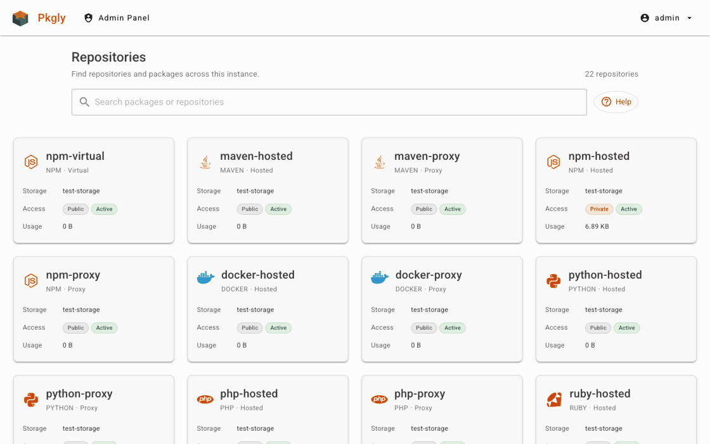

# pkgly

[](LICENSE) [](https://github.com/kshcherban/pkgly/releases) [](https://github.com/kshcherban/pkgly/actions/workflows/docker-image.yml) [](https://docs.pkgly.dev/)

**Host private packages and cache public registries on your own infrastructure.**

Pkgly is an MIT-licensed package registry and artifact manager, built with Rust, Axum, PostgreSQL, and Vue. It provides hosted, proxy, and virtual repositories, local or S3 storage, SSO, scoped API tokens, repository permissions, and package search.



[Website](https://pkgly.dev) · [Quickstart](https://docs.pkgly.dev/quickstart) · [Features](https://docs.pkgly.dev/features) · [CLI and MCP](https://docs.pkgly.dev/cli/mcp)

## Quickstart

Requires Docker Engine, Docker Compose v2, Bash, and curl on Linux or macOS (Docker Desktop works too). No Rust, Node.js, or source build is required.

```bash
curl -fsSL https://pkgly.dev/install.sh | bash
```

Open **http://localhost:8000/admin/install**, create your administrator account, then create a storage and repository in the UI. The installer writes files into `./pkgly`, starts Pkgly and PostgreSQL, and waits for the HTTP health check. Data persists in Docker volumes. HTTP is bound to localhost; S3 and an SSO provider are optional.

To inspect the deployment before starting it:

```bash
curl -fsSL https://pkgly.dev/install.sh -o install.sh
bash install.sh --no-start
cd pkgly
# Review compose.yaml and config.toml, then:
docker compose up --detach
```

Use `--dir PATH`, `--port PORT`, or `--version v0.1.2` to customize a fresh installation. Re-running the installer preserves existing settings. From a checkout, run `bash install.sh --dir ../pkgly-instance` to keep deployment files outside the source tree.

[Installation, upgrades, and manual Compose / Kubernetes setup](docs/docs/quickstart.md).

## Package formats

| Format | Hosted | Proxy |
| --- | --- | --- |
| npm, Maven, Python, Composer, Go, RubyGems | Yes | Yes |
| Docker / OCI, Debian, NuGet | Yes | Yes |
| Cargo, Helm | Yes | No |

Virtual repositories aggregate supported repositories behind one URL. Availability varies by format; see the [repository guides](https://docs.pkgly.dev/repositoryTypes/) for client configuration and supported modes.

## Why Pkgly?

Pkgly grew out of running Artifactory and Nexus and wanting a self-hosted registry with S3 and SSO available under an open-source license.

- Store packages on local disk or S3-compatible object storage, with a local disk cache.
- Use repository permissions, scoped tokens, SSO, and audit logging.
- Configure package retention and outbound publish/delete webhooks.
- Automate with `pkglyctl`, or connect an AI assistant through its stdio MCP server.

| Capability | Pkgly | Artifactory | Nexus |
| --- | --- | --- | --- |
| License / editions | MIT | Free distributions and commercial editions | Free Community Edition and commercial editions |
| Hosted, proxy, aggregated repositories | Supported; varies by format | Supported; varies by edition / format | Supported; varies by edition / format |
| S3 storage and SSO | Included | Check edition availability | Pro and above |
| Licensed component / request limits | None | Check edition terms | CE: 40,000 components, 100,000 requests/day |

Vendor offerings checked November 2026: [JFrog](https://jfrog.com/pricing/), [Sonatype editions](https://help.sonatype.com/en/nexus-repository-tiers-and-feature-availability.html). This is a comparison of selected capabilities, not a claim of feature parity.

## Project status

Pkgly is an early-stage project. Cargo and Helm are hosted-only; validate the client operations you need before migrating a registry. The [feature matrix](https://docs.pkgly.dev/features) documents current capabilities. Please [report compatibility issues](https://github.com/kshcherban/pkgly/issues) with your client version and reproduction steps.

## Development

See the [development guide](docs/docs/development.md) for `./dev.sh`, tracing, logging, and instrumentation, and [CONTRIBUTING.md](CONTRIBUTING.md) for contribution guidelines.

## Credits and license

Originally developed as a fork of [nitro-repo](https://github.com/wyatt-herkamp/nitro_repo). Released under the [MIT license](LICENSE).
